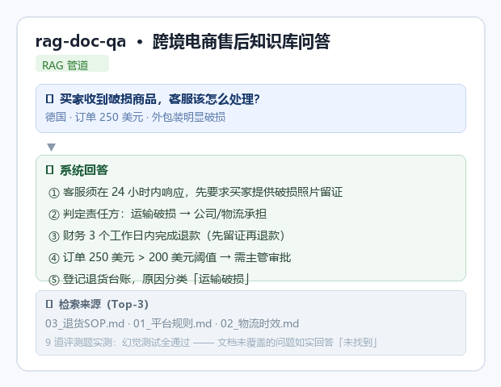

# 🛒 跨境电商售后知识库问答助手（rag-doc-qa）

为跨境电商团队做的本地文档智能问答系统，专门针对**售后规则**场景：平台退货政策、物流时效、破损处理 SOP、客服话术。

**核心价值**：新客服上岗前花 30 秒把知识库跑一遍，遇到买家提问时直接问系统，答案带来源、可追溯、不编造。

<p align="center">
  
</p>

<p align="center"><em>▲ 真实问答示例：破损商品处理流程（系统从 3 篇文档中综合生成，答案带来源标注）</em></p>

## 业务场景

系统内置一套完整的**模拟跨境电商售后知识库**（4 篇文档，2000+ 字）：

| 文档 | 内容 |
| ---- | ---- |
| `01_平台规则.md` | 四大平台（Amazon US/UK、TikTok Shop、独立站）退货窗口、退款时限 |
| `02_物流时效.md` | 各国家/地区签收超时判定、主动跟进阈值 |
| `03_退货SOP.md` | 破损商品处理流程、责任判定、升级规则 |
| `04_客服话术.md` | 常见场景的应答模板 |

把这套文档换掉，就能给任何一个行业做售后知识库——换成餐饮门店 SOP、酒店入住指南、工厂设备手册，原理一样。

## 实测效果

系统内置 9 道评测题（`eval/questions.json`），覆盖 5 类考察维度，实测全部通过：

```bash
# 直接运行评测（需要本地代理池运行）
python run_eval.py

# 跑评测并生成指标报告（baseline.json）
python eval/metrics.py
```

## 评测指标

`eval/metrics.py` 用纯 Python 实现了三个可量化指标，不依赖外部 ML 库：

| 指标 | 说明 | 基线值 |
|---|---|---|
| **faithfulness** | 答案中的事实断言在检索文档中出现的比例（字符串匹配近似） | **0.635** |
| **retrieval_coverage** | 期望来源文档是否被实际检索命中（1.0 = 全部命中） | **1.000** |
| **context_precision@3** | Top-3 片段中包含答案关键数字的占比 | **0.917** |
| **hallucination_rate** | 幻觉率（F 类陷阱题中编造具体事实的比例） | **0.000** |

> 注：faithfulness 用字符串匹配近似，多文档叠加题（C/D/E 类）分数偏低是预期现象——答案综合了 3 篇文档，单条事实不一定逐字出现在某一条检索片段里。真正重要的是 **hallucination_rate = 0**：9 道陷阱题全部正确拒绝，没有编造。

**分类评测结果**（完整数据见 `eval/results/baseline.json`）：

| 类别 | 题数 | 考察维度 | 实测 |
|---|---|---|---|
| **A** 单点事实 | 2 | 基本召回 | ✅ 全对 |
| **B** 表格数据 | 1 | 表格理解（很多 RAG 在表格上翻车） | ✅ 全对 |
| **C** 跨文档聚合 | 2 | 多路召回 + 规则叠加 | ✅ 全对 |
| **D** 概念区分 | 1 | 近似概念辨析 | ✅ 全对 |
| **E** 条件推理 | 1 | 按条件触发规则 | ✅ 全对 |
| **F** 陷阱题（幻觉测试）| 2 | 文档没有答案时能否拒绝编造 | ✅ 全对 |

**A 类示例**
> 问：TikTok Shop 的结算周期是多久？
> 答：7 天（签收后 7 天）
> 📎 来源：01_平台规则.md、04_客服话术.md

**B 类示例**
> 问：四个平台的退货窗口分别是多少天？
> 答：Amazon US/UK 30 天，TikTok Shop 7 天，独立站文档中未列出
> （正确识别出文档没写到的，没有编造）

**F 类示例（幻觉测试）**
> 问：美国站的广告投放 ROI 标准是多少？
> 答：**文档中未找到相关信息**（拒绝编造）

## 技术栈

| 组件 | 选型 | 说明 |
| ---- | ---- | ---- |
| 文档加载 | LangChain DirectoryLoader | 自动加载 `docs/` 下 .txt / .md |
| 文本切分 | RecursiveCharacterTextSplitter | 500 字符 / 100 重叠 |
| 本地向量 | sentence-transformers（all-MiniLM-L6-v2） | 免费，不出网 |
| 向量库 | Chroma | 持久化到本地磁盘，重启不用重建 |
| 生成模型 | MiMo-V2.5（mimo-auto） | 本机代理池，OpenAI 兼容协议 |

**架构一句话**（text）：
```text
用户提问 → 本地 Embedding 向量化 → Chroma 检索 Top-3 → 
拼入 LLM 提示词（附「查不到就说不」规则）→ MiMo 生成回答 + 来源标注
```

## 快速开始

```bash
# 1. 安装依赖
pip install -r requirements.txt

# 2. 直接运行（自动创建示例文档 + 跑内置 9 道评测题）
python app.py

# 3. 用自己的文档
# 把自己的 .txt / .md 放到 docs/，删除 chroma_db/（强制重建索引），再运行
```

## 目录

```text
app.py                主程序（手写管道版，不依赖 LangChain）
examples/langchain_pipeline.py  LangChain 版（同一套文档 + 同一套评测题，展示另一条路径）
run_eval.py           跑 9 道评测题并输出报告
eval_questions.txt    评测题库
docs/                 示例知识库（4 篇售后文档）
chroma_db/            向量库（运行时生成）
```

## License

MIT
